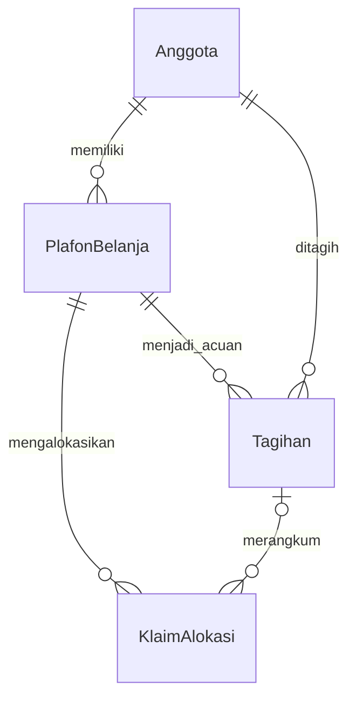

# Backend SIKopDes KD5

Backend menggunakan Spring Boot dengan Java 25. Package utama berada di `apap.ti.sikopdes`, dengan `Application` sebagai entry point sekaligus pengaktif scheduling.

## Struktur proyek

```text
apap/ti/sikopdes/
|-- config/       Clock, seeder anggota, dan overdue scheduler
|-- controller/   Penerimaan request dan pengiriman response HTTP
|-- dto/          Bentuk request, response view, dan API envelope
|-- exception/    Business error dan penanganan exception
|-- mapper/       Pemetaan entity menjadi response DTO
|-- model/        Entity JPA dan konstanta status
|-- repository/   Akses database dan deklarasi lock
`-- service/      Aturan bisnis, transaksi, dan perhitungan
```

Controller meneruskan pekerjaan ke service, lalu service menggunakan repository untuk mengakses data. Controller tidak menghitung saldo atau mengubah status secara mandiri. Dependency diberikan melalui constructor agar kebutuhan setiap class terlihat jelas.

## Pembagian tanggung jawab

| Service | Tanggung jawab |
|---|---|
| `AnggotaService` | Menyediakan anggota sebagai referensi plafon dan tagihan. |
| `PlafonService` | Memeriksa kelayakan anggota, mengatur limit/status, dan menutup plafon. |
| `KlaimService` | Mencatat, mengubah, atau membatalkan klaim beserta penyesuaian pemakaian plafon. |
| `TagihanService` | Menggabungkan klaim, mencatat cicilan, melunasi, dan membatalkan tagihan. |
| `ReportService` | Menyusun ringkasan dashboard dan statistik piutang per periode. |

Detail teknis yang dipakai bersama dipisahkan dari service fitur:

- `EntityLookup` menangani pencarian entity dan urutan penguncian anggota.
- `IdentifierService` menghasilkan ID PLF, KLM, dan TGH melalui database sequence.
- `Money` mengerjakan operasi nominal menggunakan BigDecimal secara internal.
- `LateFeePolicy` menghitung keterlambatan dan menerapkan denda satu kali.
- `ViewMapper` membentuk data untuk client, termasuk nama anggota, saldo, dan rincian klaim.

`OverdueScheduler` memeriksa tagihan setiap menit. `MemberSeeder` menggunakan Datafaker untuk membuat 15 anggota hanya ketika tabel anggota masih kosong.

## Model dan relasi data

| Entity | Peran |
|---|---|
| `Anggota` | Referensi identitas dan status keanggotaan. |
| `PlafonBelanja` | Batas kredit, pemakaian, dan status fasilitas belanja tempo. |
| `KlaimAlokasi` | Transaksi yang menggunakan sebagian plafon anggota. |
| `Tagihan` | Kumpulan klaim beserta jatuh tempo dan akumulasi pembayarannya. |



Tabel berada di database `sikopdes`, schema `public`. Hibernate membentuk struktur dari entity melalui `ddl-auto: update`, termasuk foreign key antar-tabel. DBeaver dapat membaca struktur tersebut dan menampilkan diagram relasinya.

Satu anggota hanya boleh memiliki satu plafon Aktif/Dibekukan. Referensi tagihan pada klaim masih kosong selama klaim belum ditagih. `BaseEntity` menampung ID, timestamp, dan version yang digunakan bersama.

## Konsistensi transaksi

Perubahan saldo, status, dan relasi dijalankan dalam transaction. Lock pada anggota menjaga agar request bersamaan untuk anggota yang sama tidak memakai plafon atau menagih klaim secara ganda. Version pada entity membantu mendeteksi konflik perubahan.

Beberapa aturan yang memengaruhi perhitungan:

- Field nominal tetap memakai `double` sesuai spesifikasi; operasi internal memakai BigDecimal dan pembulatan dua desimal.
- Cicilan belum memulihkan plafon. Pemulihan dilakukan ketika tagihan sudah lunas, sekaligus mengubah semua klaim terkait menjadi Lunas.
- Pengurangan pemakaian saat lunas mengikuti total tagihan, dengan batas bawah sebesar alokasi klaim lain yang masih berjalan atau nol. Denda tidak boleh membuat saldo negatif atau mengurangi alokasi transaksi lain.
- Pembatalan memakai perubahan status. Plafon Ditutup serta tagihan Lunas/Dibatalkan bersifat final.
- Waktu bisnis memakai Asia/Jakarta. Jatuh tempo berlaku sampai akhir hari dengan presisi yang sesuai penyimpanan PostgreSQL.

## Kontrak API

Endpoint memakai awalan `/api`, dengan kelompok `/anggota`, `/plafon`, `/klaim`, `/tagihan`, dan `/dashboard`. Controller menerima GET, POST, PUT, atau DELETE sesuai operasi yang diminta. Daftar request beserta contoh payload tersedia di [collection Postman](postman/SIKopDes.postman_collection.json).

Setiap response memakai bentuk yang sama:

```json
{
  "status": 200,
  "message": "Success",
  "timestamp": "2026-10-23T18:00:00+07:00",
  "data": []
}
```

`Requests` membatasi input client, sedangkan `Views` dan `ViewMapper` membentuk output tanpa mengirim entity JPA secara langsung. `BusinessException` mewakili penolakan aturan bisnis; `GlobalExceptionHandler` menerjemahkannya menjadi HTTP status dan pesan yang sesuai. PDF tagihan dibuat di frontend dari data detail tagihan.
